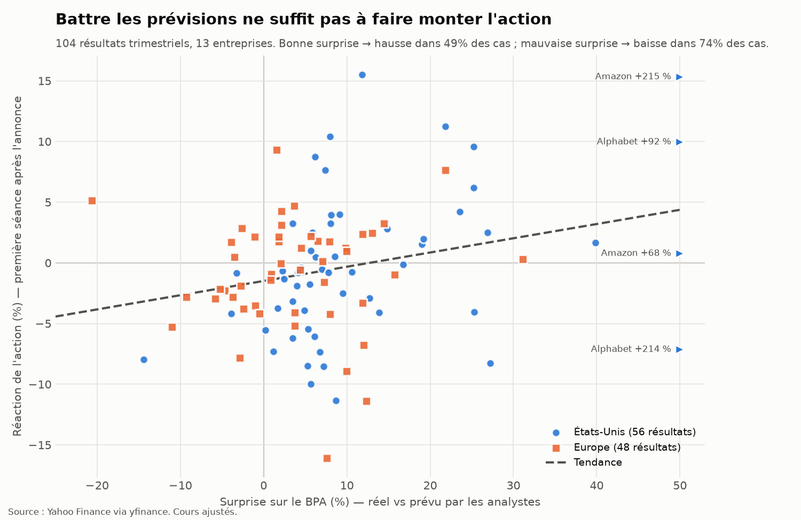

# Earnings Surprise

**Quand une entreprise annonce des bénéfices meilleurs (ou pires) que prévu, comment réagit son action en bourse ?**

Ce projet compare, résultat par résultat :

- le **bénéfice par action (BPA) prévu** par les analystes,
- le **BPA réellement publié**,
- la **surprise** en % (écart entre les deux),
- la **réaction de l'action** à la première séance qui suit l'annonce.

Une bonne surprise fait-elle vraiment monter l'action ? Pas toujours : les marchés anticipent souvent, et d'autres éléments (chiffre d'affaires, prévisions de la direction) pèsent aussi.

## Exemple

```
$ python main.py AMZN

AMZN — 8 derniers résultats

                   Moment  BPA prévu  BPA réel  Surprise (%)  Réaction (%)
Date
2026-07-30  après clôture       1.83      5.75        214.89         15.32
2026-04-29  après clôture       1.65      2.78         68.18          0.77
2026-02-05  après clôture       1.95      1.95          0.22         -5.55
2025-10-30  après clôture       1.56      1.95         25.20          9.58
2025-07-31  après clôture       1.32      1.68         27.19         -8.27
...

Bonnes surprises : 8/8, dont 4 suivies d'une hausse de l'action.
```

## Plusieurs actions

`python multi.py` applique l'analyse à 13 entreprises (Apple, Amazon, Microsoft, Alphabet, Nvidia, Meta, JPMorgan, TotalEnergies, Airbus, Sanofi, BNP Paribas, ASML, SAP), soit 104 résultats trimestriels, puis `python scatter.py` trace le nuage de points :



Ce qui en ressort :

- **Une mauvaise surprise est presque toujours punie** : baisse dans 74 % des cas (−2,1 % en moyenne).
- **Une bonne surprise n'est pas récompensée pour autant** : hausse dans 49 % des cas seulement, réaction moyenne proche de zéro. Battre le consensus est déjà attendu par le marché.
- La corrélation (de rangs) entre surprise et réaction est faible (+0,25), et varie beaucoup d'une entreprise à l'autre : forte pour Microsoft ou JPMorgan (+0,71), négative pour ASML ou SAP.

LVMH, L'Oréal et Hermès ne figurent pas dans l'échantillon : Yahoo Finance n'a pas d'historique de BPA prévu/réel pour eux (ils publient surtout des résultats semestriels).

## Comment la réaction est calculée

- Annonce **avant l'ouverture** : clôture du jour de l'annonce vs clôture de la veille.
- Annonce **après la clôture** : clôture du lendemain vs clôture du jour de l'annonce.
- **Heure incertaine** (Yahoo indique une heure en pleine séance, souvent approximative pour les valeurs européennes) : clôture du lendemain vs clôture de la veille.

Yahoo donne les heures d'annonce en heure de New York ; elles sont converties dans le fuseau de la place de cotation (Paris, Amsterdam, Francfort…) avant de choisir la fenêtre.

Les cours sont ajustés des dividendes et divisions d'actions.

## Installation

```bash
python3 -m venv .venv
source .venv/bin/activate
pip install -r requirements.txt
python main.py          # Amazon par défaut
python main.py AAPL     # ou n'importe quel ticker Yahoo Finance
python multi.py         # 13 entreprises, enregistre data/reactions.csv
python scatter.py       # nuage de points -> scatter.png
```

## Feuille de route

1. ✅ Une seule action : les 8 derniers résultats
2. ✅ Plusieurs actions : une bonne surprise fait-elle monter l'action ?
3. ✅ Graphique : nuage de points surprise vs réaction
4. Application web Streamlit : on tape un ticker, l'analyse s'affiche
5. Bonus : comparer les BPA GAAP et normalisés (non-GAAP), via le paramètre `methodology` ajouté à yfinance

## Données

Données issues de Yahoo Finance via [yfinance](https://github.com/ranaroussi/yfinance). Projet pédagogique, pas un conseil en investissement.
